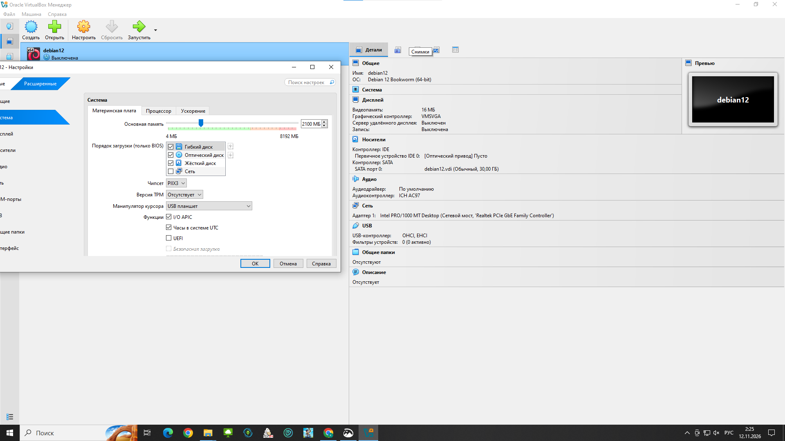
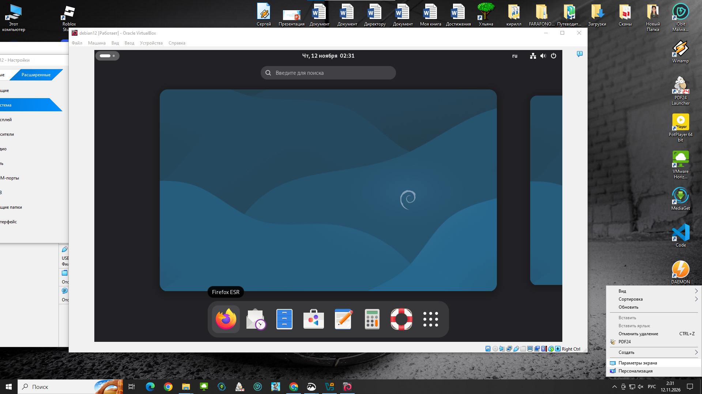
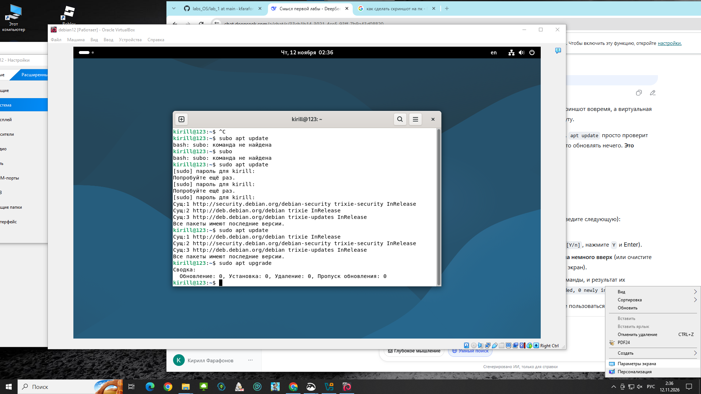
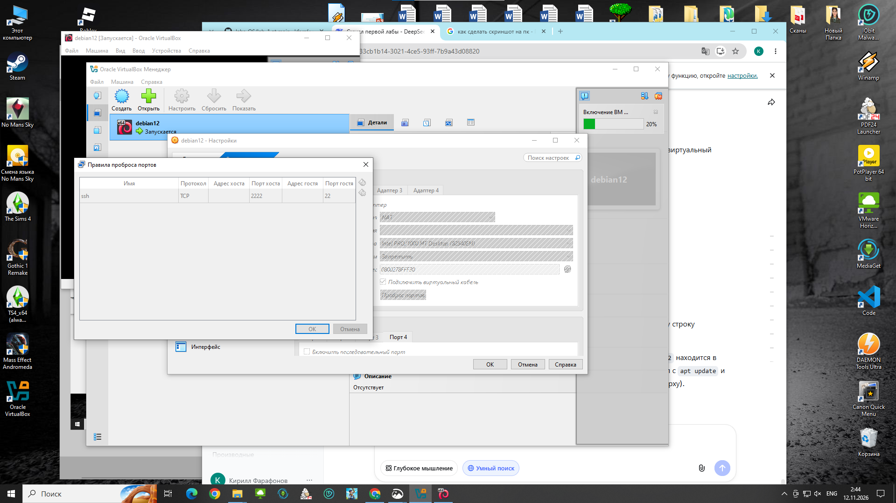
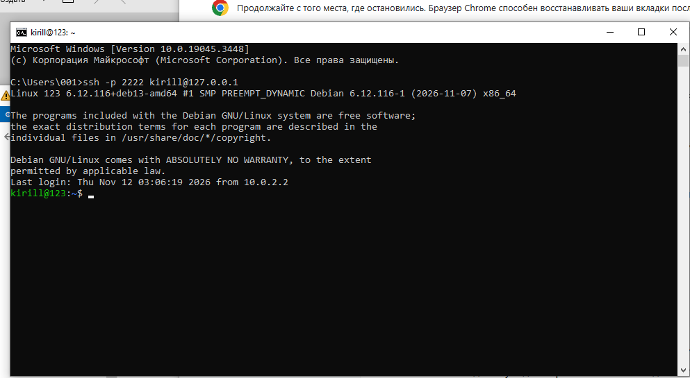
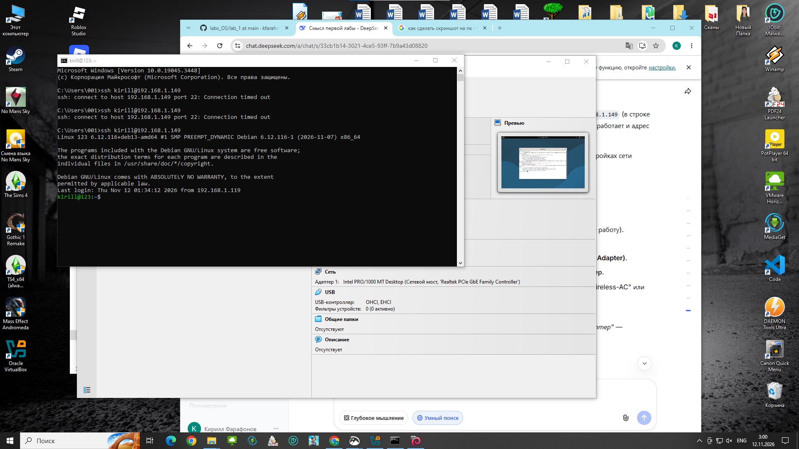

# Лабораторная работа № 1.
Установка Debian на виртуальную машину и настройка SSH

---
**ФИО студента:** Фарафонов Кирилл Олегович
**Группа:** ИС-25
---

## Цель работы
Получить практические навыки установки и настройки операционной системы Debian на виртуальной машине, а также освоить базовое администрирование и удаленный доступ по протоколу SSH.

## Ход работы

### 1. Настройка виртуальной машины
В программе Oracle VM VirtualBox была создана новая виртуальная машина. В соответствии с требованиями, для неё были выделены следующие ресурсы:
* Оперативная память: 2100 МБ (в пределах требуемых 2–4 ГБ).
* Жесткий диск: 30 ГБ.

### 2. Установка Debian и настройка системы
Был скачан ISO-образ Debian и произведена установка на виртуальную машину. В процессе установки были заданы основные параметры: имя компьютера (debian12), язык, часовой пояс, а также создан пользователь `kreep`. Система успешно загружается, работает графический интерфейс.

### 3. Обновление системы
После подключения к интернету было выполнено обновление списков пакетов и самой системы с помощью команд:
`sudo apt update`
`sudo apt upgrade`
Система обновлена, все пакеты имеют последние версии.

### 4. Настройка сети в режиме NAT и проброс портов
Для доступа к виртуальной машине с основного компьютера в режиме NAT было настроено правило проброса портов (Port Forwarding): порт хоста `2222` перенаправляется на порт гостя `22` (стандартный порт SSH).

### 5. Проверка доступа по SSH (по ключу)
С основного компьютера (ОС Windows) было выполнено успешное подключение к виртуальной машине с использованием сгенерированного SSH-ключа. Вход выполнен без запроса пароля, что подтверждает правильную настройку SSH-сервера и авторизации по ключам.
Команда подключения: `ssh -p 2222 kirill@127.0.0.1`

### 6. Проверка режима «Сетевой мост» (Bridged)
Дополнительно была проверена работа сети в режиме «Сетевой мост» с привязкой к физическому сетевому адаптеру. Виртуальная машина получила IP-адрес из локальной сети (`192.168.1.149`), и было выполнено подключение по SSH напрямую по этому адресу.

---

## Вывод
В ходе выполнения лабораторной работы была успешно развернута виртуальная машина с операционной системой Debian 12. Освоены навыки обновления системы через пакетный менеджер `apt`, настройки сетевых интерфейсов в режимах NAT (с пробросом портов) и Bridged. Настроен и проверен удаленный доступ к машине по протоколу SSH (как по паролю, так и с использованием ключей аутентификации).
